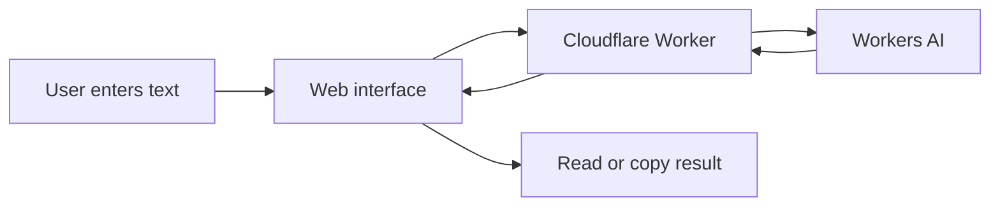

 <div align="center">

# PlainSpeak AI

### Make complicated English easier to understand.

Turn dense text into clear, useful language — without losing sight of the original meaning.

**[Open the live app ↗](https://plainspeak-ai.moinacksaha66.workers.dev) · [View source code](https://github.com/MaxWasFound/PlainSpeak-AI)**


</div>

---

## ✦ What is PlainSpeak?

PlainSpeak AI is an AI-powered writing clarity tool that helps people understand difficult passages, identify key information, and learn unfamiliar vocabulary.

Built as an independent project, it combines a responsive web interface with a server-side Cloudflare Worker that connects to Workers AI.

## ⚡ Features

| Mode | Purpose |
|---|---|
| **Simplify** | Rewrite complicated text in clearer English. |
| **Summarize** | Condense long passages into key points. |
| **Explain Words** | Understand unfamiliar or technical vocabulary. |

Additional features include:

- Responsive interface for desktop and mobile.
- Copy generated results.
- Bounded text input.
- Server-side AI requests without exposing an AI API key in browser JavaScript.

## 🖥️ Preview

<!-- Add a real screenshot at docs/images/plainspeak-preview.png and uncomment the next line. -->
<!--  -->

**[Try the live version →](https://plainspeak-ai.moinacksaha66.workers.dev)**

## 🧭 Architecture



## 🧰 Tech stack

- **Frontend:** HTML, CSS, vanilla JavaScript
- **Backend:** Cloudflare Workers
- **AI inference:** Cloudflare Workers AI
- **Hosting:** Cloudflare Workers and static assets

## 🚀 Run locally

### Requirements

- [Node.js](https://nodejs.org/) with npm
- A [Cloudflare account](https://dash.cloudflare.com/) with Workers AI access

### Installation

```bash
git clone https://github.com/MaxWasFound/PlainSpeak-AI.git
cd PlainSpeak-AI
npm install
npx wrangler login
npx wrangler dev
```

Open the local URL printed in your terminal.

### Deploy

After signing in and checking `wrangler.jsonc`, run:

```bash
npx wrangler deploy
```

Follow any prompts required to enable or authorize Workers AI. Availability and quotas depend on your Cloudflare account and current service terms.

## 📁 Project structure

```text
PlainSpeak-AI/
├── public/
│   ├── index.html
│   ├── styles.css
│   └── app.js
├── src/
│   └── index.js
├── package.json
├── wrangler.jsonc
└── README.md
```

## 🔐 Responsible use

- Don't submit passwords, private records, or other sensitive information.
- AI-generated text may omit context or change nuance. Verify important information against the original.
- The Worker currently limits input to 8,000 characters.
- The project does not currently include user accounts, saved history, analytics, or a complete abuse-prevention system.

## 🛣️ Roadmap

- Add real interface screenshots and a short demo GIF.
- Test the three modes against example passages.
- Improve accessibility and error handling.
- Explore additional language support after the English experience is reliable.

## 👤 Built by

**Max** — an independent project exploring practical AI, web development, and clear communication.

## © Ownership & third-party notices

The PlainSpeak AI name, original branding, page copy, and original project code are presented as the work of Max unless otherwise noted. Third-party libraries, AI models, fonts, and platform services remain subject to their own licenses and terms.

No open-source license is included by default. Reuse permissions should be made explicit by adding a suitable license if open-source distribution is intended.

---

<div align="center">

**Less confusion. More clarity.**

[Try PlainSpeak AI](https://plainspeak-ai.moinacksaha66.workers.dev)

</div>
